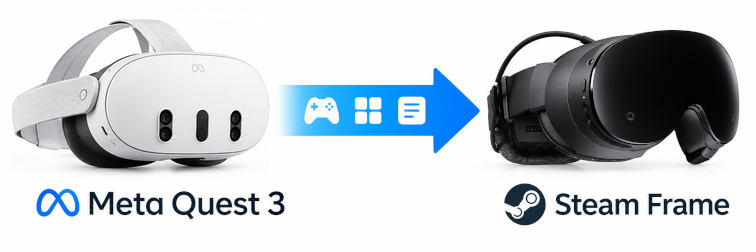

title: De Meta Quest 3 a Steam Frame con FramePort
summary: Cómo llevar los juegos/aplicaciones comprados en la tienda de Meta a las Valve Steam Frame.
date: 2026-10-15 20:30:00



Desde que escribí [Aventuras en VR](2022-04-17_vr.md) la realidad virtual ha ido ganando peso en mis intereses y tiempo libre. De aquellas Oculus Quest 2 pasé a las Meta Quest 3 y, con ellas, fui comprando en la tienda de Meta una cantidad de juegos/aplicaciones considerable. Ahora estoy en proceso de migración a las Valve Steam Frame y el problema del cambio de plataforma es serio. Desde el punto de vista económico (no quiero perder todo lo invertido) y logístico (no quiero tener dos visores equivalentes e idealmente me gustaría vender las Quest y recuperar parte de la inversión).

Buscando cómo resolverlo o al menos mitigarlo, di con [**FramePort**](https://github.com/spoopyghosty0/frameport), un proyecto libre que instala juegos de Quest, aplicaciones Android y juegos PC VR en las Steam Frame. No se limita a copiar la aplicación. Convierte sus llamadas de VR al estándar OpenXR y le aplica parches para que arranque en las Frame. Para que haga su magia, uno tiene que aportar los paquetes de los juegos. Y ahí estaba todo el trabajo, sacar del visor los juegos que ya tengo comprados.

De eso se encargaron dos scripts que escribió mi agente (Hermes, el del [hace un par de artículos](2026-08-23_hermes_agent_vps.html)). El primero, `extract-quest-games.sh`, baja los ficheros de cada juego instalado y los coloca donde FramePort los espera. El segundo, `identify-quest-games.py`, averigua a qué juego corresponde cada paquete. En este artículo cuento qué hace FramePort, cómo se preparan el visor y el ordenador, y dejo el procedimiento completo que seguí con Hermes, paso a paso, para llevar una biblioteca comprada en Meta a unas Steam Frame.

## Los juegos de Quest por dentro

Las Meta Quest funcionan sobre Android (Horizon OS) y eso, para lo que nos ocupa, es una suerte. Cada juego instalado es un paquete de Android como los de cualquier móvil.

* **El APK**: el programa. A veces es uno solo y a veces viene troceado en un `base.apk` más varios `split_config.*.apk`.
* **Los OBB**: los datos del juego (texturas, niveles, audio) que no van dentro del APK. En el visor viven en `/sdcard/Android/obb/<package>/`.

Las gafas no enseñan nada de esto al usuario, pero sí al protocolo de depuración de Android (`adb`), la misma herramienta que se usa para interactuar con el sistema de un teléfono Android.

## Qué hace FramePort (y qué no)

FramePort es software libre (GPL-3.0) y corre en Windows, macOS y Linux. Por dentro encadena varias piezas:

* **OVRPort**: traduce las llamadas de VR propias de Meta al OpenXR estándar que entienden las Steam Frame. Es la conversión que permite que un juego hecho para el visor de Meta se ejecute en el visor de Valve.
* **Lepton**: el runtime de Android de Valve en las Frame, que es donde corre el juego ya convertido.
* **Recetas**: parches y ajustes probados por la comunidad para más de 120 juegos, que se actualizan solos sin tocar los ficheros del usuario.
* **Proton** y **FEX**: para juegos PC VR y programas de Windows, que no es lo que nos ocupa hoy.

!!! Note "Juegos comprados"
    Todo el procedimiento trabaja sobre lo que ya está instalado en mis gafas con mi cuenta: no hay descargas de terceros ni herramientas de desbloqueo. FramePort tampoco las necesita ni las ofrece.

## Preparar el visor: modo desarrollador

Antes de que las Quest hablen con el ordenador hay que activarles el modo desarrollador. Es un trámite corto, pero tiene un paso que puede dar guerra si no se conoce:

1. **Cuenta de desarrollador con organización.** En `developer.oculus.com` hay que crear una organización (gratis). Sin ella el interruptor del modo desarrollador sencillamente no aparece en la aplicación del móvil.
2. **Activar el modo.** En la aplicación **Meta Horizon** del teléfono: visor → *Headset Settings* → *Developer Mode* → activar. El visor pide reiniciarse.
3. **Autorizar el ordenador.** Con el cable USB-C (de datos, no de solo carga) y el visor puesto, aparece un diálogo de depuración USB. Se acepta y se marca *Always allow from this computer*.

La comprobación de que todo está en su sitio es `adb devices`, que debe responder `device`. Si responde `unauthorized`, el diálogo del paso 3 no se ha aceptado.

## Preparar el ordenador: adb

`adb` viene con el paquete `android-tools` en Arch y con `adb` en Ubuntu. En Linux hace falta además una regla `udev`, porque sin ella solo funciona como root:

```bash
echo 'SUBSYSTEM=="usb", ATTR{idVendor}=="2833", MODE="0666", GROUP="plugdev"' | sudo tee /etc/udev/rules.d/51-android.rules
sudo udevadm control --reload-rules && sudo udevadm trigger
```

## Extraer los juegos del visor

A FramePort hay que darle una estructura concreta de ficheros para cada juego. Una carpeta por juego, el APK dentro de ella y una subcarpeta con el nombre exacto del paquete que contiene los OBB:

```txt
QuestGames/
└── com.Armature.VR4/                ← una carpeta por juego (el nombre da igual)
    ├── base.apk                     ← el APK, o varios si va troceado
    └── com.Armature.VR4/            ← carpeta de datos: EXACTAMENTE el package name
        ├── main.203.com.Armature.VR4.obb
        └── patch.203.com.Armature.VR4.obb
```

Los trozos de un mismo juego van juntos (varios APK dentro de una carpeta cuentan como un solo juego) y los OBB no se renombran nunca, porque el juego los busca por su nombre exacto.

El script recorre las aplicaciones del visor, copia todos los APK de cada una y arrastra su carpeta de OBB al sitio correcto.

```bash
#!/usr/bin/env bash
# Extrae APK(s) + OBB de los juegos instalados en un Meta Quest y los deja con el
# layout que FramePort escanea:
#   <JUEGOS>/<package>/<base.apk y splits>        (uno o varios APK por juego)
#   <JUEGOS>/<package>/<package>/<*.obb>          (carpeta de datos = package name)
#
# Uso:  ./extract-quest-games.sh [DESTINO] [PREFIJO_PAQUETE]
#       ./extract-quest-games.sh ~/QuestGames com.
#
# ADB se puede sobreescribir (ADB=./mockadb) para probarlo sin visor.
set -euo pipefail

OUT="${1:-$PWD/QuestGames}"
FILTER="${2:-}"
ADB="${ADB:-adb}"

command -v "$ADB" >/dev/null || { echo "adb no está en el PATH" >&2; exit 1; }
[ "$("$ADB" get-state 2>/dev/null)" = device ] \
  || { echo "Quest no autorizado: ejecuta 'adb devices' y acepta en el visor" >&2; exit 1; }
mkdir -p "$OUT"

mapfile -t PKGS < <("$ADB" shell pm list packages -3 | tr -d '\r' | sed 's/^package://' | grep -v '^$' |
  { if [ -n "$FILTER" ]; then grep "^$FILTER" || true; else cat; fi; } | sort)
[ "${#PKGS[@]}" -gt 0 ] || { echo "sin apps que coincidan con '$FILTER'" >&2; exit 1; }

for pkg in "${PKGS[@]}"; do
  dest="$OUT/$pkg"; mkdir -p "$dest"; n=0
  while IFS= read -r apk; do                       # base.apk + split_config.*.apk -> dest/
    apk="${apk#package:}"; [ -n "$apk" ] || continue
    "$ADB" pull -a "$apk" "$dest/" >/dev/null 2>&1 && n=$((n + 1))
  done < <("$ADB" shell pm path "$pkg" | tr -d '\r')

  [ "$n" -gt 0 ] || { echo "[skip] $pkg (sin APK accesible)"; rmdir "$dest" 2>/dev/null || true; continue; }

  src="/sdcard/Android/obb/$pkg"
  if [ -n "$("$ADB" shell "ls -A $src 2>/dev/null" | tr -d '\r')" ]; then
    "$ADB" pull "$src" "$dest/" >/dev/null 2>&1      # crea dest/<package>/
    echo "[ok] $pkg — $n APK + OBB"
  else
    echo "[ok] $pkg — $n APK (sin OBB)"
  fi
done

echo
echo "Importa en FramePort:  Add games → Scan a folder… → $OUT"
```

Se guarda en el ordenador, se le da permiso de ejecución y se lanza:

```bash
chmod +x extract-quest-games.sh
./extract-quest-games.sh ~/QuestGames        # todos los juegos
./extract-quest-games.sh ~/QuestGames com.   # solo los que empiecen por "com."
```

[Descargar extract-quest-games.sh](files/posts/2026-10-15_quest_frameport/extract-quest-games.sh)

Con eso la carpeta `~/QuestGames` ya contiene el material con el layout que FramePort escanea.

!!! Note "Descarga por lotes"
    Mis Quest 3 son la versión de 128GB. Hace mucho tiempo que no puedo tener todos los juegos adquiridos descargados a la vez. Muchas veces para instalar un juego nuevo (o viejo que me apetece rejugar) tenía que desinstalar otro. Ahora para hacer esta descarga de todos los juegos de la biblioteca, he tenido que ejecutar el script varias veces habiendo borrado todos los juegos al principio e instalado un lote de la biblioteca para hacer la descarga.

## Identificar cada paquete

Hay paquetes que se explican solos (`com.Arvore.Yuki` es Yuki), pero en otros costaba deducir qué juegos eran a partir del paquete.

El nombre está dentro del APK, pero no se puede leer a mano. El `AndroidManifest.xml` que aparece al abrir el fichero APK (con cualquier descompresor) no es XML de texto, está en **formato binario** (AXML), y el nombre de la aplicación es casi siempre una **referencia** a un recurso (`@string/app_name`) que hay que resolver contra la tabla de recursos del APK.

La pieza que hace ese trabajo es `androguard`, una biblioteca de Python que no necesita ni el SDK de Android ni Java:

```bash
python3 -m venv ~/.venvs/apkid
~/.venvs/apkid/bin/pip install androguard
```

El segundo script recorre la carpeta de juegos, elige el APK base de cada uno (el `base.apk`, no los `split_config.*`), lee su manifiesto y escribe tres cosas:

| Fichero | Contenido |
| --- | --- |
| `mapping.tsv` | paquete, nombre, versión, actividad principal, carpeta y APK |
| `icons/<package>.png` | el icono de cada juego a 192 px |
| `iconos.html` | listado con icono, nombre y paquete, para poner cara a los dudosos |

```bash
~/.venvs/apkid/bin/python identify-quest-games.py ~/QuestGames            # solo informa
~/.venvs/apkid/bin/python identify-quest-games.py ~/QuestGames --rename   # además renombra
```

El renombrado deja cada carpeta como `Nombre [package]`, que se lee mucho mejor, y no toca nada si el destino ya existe, así que se puede repetir sin miedo.

[Descargar identify-quest-games.py](files/posts/2026-10-15_quest_frameport/identify-quest-games.py)

!!! Tip "El nombre del visor no es el de la tienda"
    Lo que saca el script es el nombre con el que el juego se presenta en el visor, que no siempre coincide con el de su ficha en la tienda de Meta. Para resolver esas dudas ayuda el listado generado en `iconos.html`.

## Instalarlo en las Steam Frame

Con la carpeta preparada, el resto se hace en FramePort: **Add games → Scan a folder...** apuntando a `~/QuestGames` (el escaneo busca hasta cinco niveles de profundidad) o **Add an APK...** para un juego suelto.

Los juegos aparecen en la biblioteca con su carátula y, desde ahí, **Install on Frame** los parchea, los sube al visor y los añade a la biblioteca de Steam. Los ficheros que se quedan en el ordenador no se tocan: FramePort trabaja sobre una copia.

## Lo que no va a funcionar

Hay límites que ningún parche arregla:

| Caso | Por qué |
| --- | --- |
| Juegos solo de 32 bits | Las Frame no ejecutan aplicaciones de 32 bits. Aunque parece que a partir de la [versión 1.2.0](https://github.com/spoopyghosty0/frameport/releases/tag/v1.2.0) se ha incluido un conversor 32-64 bit. |
| Juegos solo x86 | El procesador de las Frame es ARM. |
| Juegos de los sistemas de Pico o HTC | Usan su propia capa de VR, no la de Meta. |
| Aplicaciones de Android XR | Otro sistema por debajo. |
| Juegos que validan la licencia en la aplicación de Oculus | Piden un servicio que las Frame no tienen. |

Ninguno de estos límites se detecta al extraer, se ven al instalar y lanzar el juego en el visor, así que la lista de lo que funciona se va descubriendo juego a juego.

## Conclusión

Con los dos scripts (con el primero en realidad), una biblioteca que estaba atada a las gafas de Meta se convierte en una carpeta de ficheros que puedo instalar en las Steam Frame. La extracción es un rato de terminal, y a partir de ahí FramePort hace el resto.

Queda trabajo por delante. La migración no es copiar y listo. Hay juegos que no van a arrancar nunca por los límites de arriba y otros necesitarán ajustes, y es muy posible que con otra biblioteca aparezcan casos que aquí no cuento. Pero el punto de partida ya está resuelto, y lo que compre a partir de ahora puedo llevarlo a las Frame el mismo día. Además el proyecto FramePort está en continuo desarrollo. Con cada versión se amplía el número de juegos testeados y en los que se garantiza la compatibilidad de la adaptación a las Frame.

Sobre los scripts, reconozco que hoy en día no tiene mérito obtenerlos ni casi difundirlos. Cualquiera puede fabricarlos con un buen agente de programación, pero ya que los tengo generados no cuesta nada ofrecerlos.

## Enlaces de interés

* [FramePort](https://github.com/spoopyghosty0/frameport)
* [Preguntas frecuentes de FramePort](https://github.com/spoopyghosty0/frameport/blob/main/docs/FAQ.md)
* [Compatibilidad de FramePort con los juegos de Quest](https://github.com/spoopyghosty0/frameport/blob/main/docs/COMPATIBILITY.md)
* [androguard](https://github.com/androguard/androguard)
* [SideQuest](https://sidequestvr.com/)
* [Aventuras en VR](2022-04-17_vr.md)
